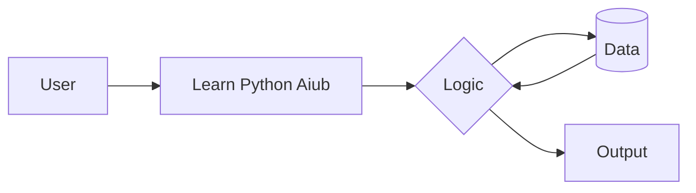

# Learn Python: Basic to Advanced

A structured Python learning repository covering fundamentals to advanced topics through practical examples and exercises.

## Architecture / How it Works

## Topics

`python` `learn-python` `python-basics` `python-programming` `python-tutorial` `python-exercises` `data-structures` `object-oriented-programming` `automation`